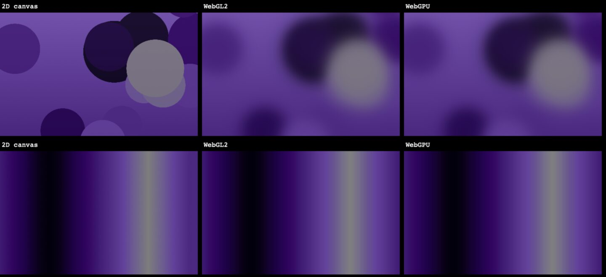

# WebGPU, WebGL2 and what Sistine draws today: energy under glass

> **Question.** Would drawing Sistine's backgrounds with WebGPU use less energy than what the library
> uses today (CSS pattern scenes and the 2D-canvas `CanvasBackground`)?
>
> **Answer.** No. WebGPU and WebGL2 measured the same, and for the default canvas style neither beat
> the 2D canvas or a CSS scene. What sets the cost is how many pixels are recomputed per frame, how much
> work each pixel takes, and how often. The API makes no difference. A still background costs nothing
> extra on the GPU, and every moving one costs at least ~0.3 W.

Measured 2026-11-04 in Safari Technology Preview on an Apple M5. Raw data:
[`data/2026-11-04-webgpu-energy.json`](data/2026-11-04-webgpu-energy.json).

---

## Results

GPU power is the reliable number here (see *Method*). **Δ GPU** is each variant minus the still page
in the same round; the range is over the three rounds. The CPU side is per process: the CPU time of
the browser's web-content and GPU processes, and of the window server, in cores (1.00 = one core
busy all the time).

| Background, under 4 glass cards | Δ GPU, W (range) | Browser CPU, cores | WindowServer, cores | DRAM, W |
|---|---|---|---|---|
| Still (one frame, nothing moves): the baseline, 1.39 W GPU | 0 | 0.00 | 0.44 | 0.46 |
| CSS `clouds` scene (Sistine today) | +0.27 (+0.26 … +0.30) | 0.06 | 0.53 | 0.68 |
| CSS `aurora` scene (Sistine today, the heaviest) | +0.90 (+0.86 … +0.91) | 0.05 | 0.52 | 0.70 |
| `gradient`, 2D canvas (Sistine today, the default style) | +0.27 (+0.14 … +0.27) | 0.09 | 0.51 | 0.70 |
| `gradient`, WebGL2 | +0.31 (+0.21 … +0.31) | 0.08 | 0.54 | 0.71 |
| `gradient`, WebGPU | +0.32 (+0.18 … +0.33) | 0.08 | 0.54 | 0.69 |
| `lava`, 2D canvas (Sistine today; **no blur in WebKit**, see below) | +0.35 (+0.33 … +0.37) | 0.11 | 0.51 | 0.77 |
| `lava`, WebGL2 (with the blur) | +1.18 (+1.08 … +1.22) | 0.08 | 0.54 | 0.68 |
| `lava`, WebGPU (with the blur) | +1.20 (+1.10 … +1.29) | 0.07 | 0.53 | 0.75 |

Without the glass cards (Δ against the still page without cards, 1.38 W GPU):

| Background, no glass | Δ GPU, W (range) | Glass added |
|---|---|---|
| CSS `aurora` | +0.66 (+0.65 … +0.74) | +0.24 |
| `lava`, 2D canvas | +0.39 (+0.34 … +0.40) | none measurable |
| `lava`, WebGPU | +1.04 (+0.93 … +1.07) | +0.16 |

### What it says

1. **WebGPU and WebGL2 cost the same.** They're within 0.02 W on both styles. WebGPU's advantage is
   less CPU work per draw call, and a background makes one draw call per frame. Both showed the same
   ~0.08 cores of browser CPU.
2. **For the default `gradient` style, switching gains nothing.** The 2D canvas, WebGL2 and WebGPU all
   add ~0.3 W, the same as the CSS `clouds` scene. The 2D canvas uses a little more browser CPU (0.09
   cores against 0.08), too little to matter.
3. **`lava` costs what its look costs.** In WebKit the 2D canvas draws hard-edged discs, because WebKit
   doesn't support the 2D canvas's `filter` property (see *A bug this found*). That's why it's cheap at
   +0.35 W. Drawing the intended blur on the GPU costs +1.2 W with either API, a little more than the
   heaviest CSS scene (`aurora`, +0.9 W). Every pixel evaluates 13 soft blobs, 5.2 million pixels,
   30 times a second.
4. **A still background is the only free one.** Anything that moves adds at least ~0.3 W of GPU, ~0.25 W
   of DRAM traffic and ~0.08 cores of window-server work. At the high end, +1.2 W is about 1.2 Wh an
   hour, roughly 1.7% of a 70 Wh laptop battery per hour.
5. **Glass costs less than expected.** Four cards over a full-window moving background added
   0.24 W to the CSS `aurora` scene, 0.16 W to WebGPU `lava`, and nothing measurable to the 2D-canvas
   `lava`. We didn't isolate why the 2D canvas showed no glass cost. The expectation going in, that
   the glass would dominate, doesn't hold for this layout: the background's own pixel work does.

### What would actually save energy

None of these was measured here.

- **Keep backgrounds still** where possible (`speed={0}`, the default). They are 0 W on the GPU.
- **A lower frame rate.** The canvases already cap at 30 fps; slow drifts could go lower.
- **Fewer pixels for soft content.** A blurred field looks the same rendered at half resolution and
  scaled up, which is a quarter of the pixel work. This is where a GPU renderer could pay off, with
  WebGL2 and WebGPU equally. It's the next thing worth measuring.

---

## A bug this found

**`CanvasBackground`'s `lava` style isn't blurred in Safari or any WebKit webview** (including the Tauri
app on macOS). `makeLava` (`lib/canvas-background-utils.ts`) blurs the blobs with
`ctx.filter = "blur(…)"`. WebKit has no `CanvasRenderingContext2D.filter`: in STP, `"filter" in ctx` is
`false`, and assigning it just adds an unused property. The style renders as hard-edged discs
(left column below). Chromium supports the property, so the style looks right there.



*Still frames at t = 0, top `lava`, bottom `gradient`; left to right 2D canvas, WebGL2, WebGPU. The
GPU ports draw the same layout and colours; only the 2D canvas's missing blur differs.*

---

## Method

**Machine.** Apple M5, macOS 27.2, two external displays attached (a 5K at 2× and a 3440×1440).
Browser: Safari Technology Preview 27.0 (WebKit 22627.1.4), a production build of this site served
locally. Window 1440×900 CSS px on the 5K display, so canvases are backed at 2880×1800. Dark theme,
amethyst tint, crystal page style. Busy apps were paused and the Mac was left alone for the run.

**Page.** [`/research/energy`](../../app/research/energy/bench.tsx) draws one full-window background with
four `Card`s (crystal glass, about a quarter of the window) on top, and nothing else that moves. It reads
a schedule from its URL and switches background on the wall clock, so the energy sampler needs no link
to the page.

**Variants.** CSS scenes are `PatternBackground` at speed 8. 2D-canvas variants are
`CanvasBackground` with its defaults (6 steps, tonal ramp, angle 90°, speed 1, seed `sistine`). The
WebGL2 and WebGPU ports ([`gpu-backgrounds.tsx`](../../app/research/energy/gpu-backgrounds.tsx)) take
exactly that input:
- the same palette, resolved to Display-P3 through the same rasteriser;
- the same seeded blob layout;
- the same backing size and the same ~30 fps cap.

Measured frame rates: 29.3–29.5 fps for all six animated canvases. CSS animations aren't capped; they
run at the display's 60 Hz.

The ports draw `lava`'s blur per pixel: a disc blurred by a Gaussian is the normal CDF of the
distance to its edge. That's how the effect would be written for a GPU, but a literal blur pass could
cost differently.

**Schedule.** 13 variants × 3 rounds; each round in a different, seeded random order. Each phase is 5 s
of settling (mount, shader compiles), not measured, then 30 s measured. 39 phases, 23 minutes.

**Energy.** [`scripts/energy/ioreport-sampler.c`](../../scripts/energy/ioreport-sampler.c) reads Apple
Silicon's *Energy Model* IOReport counters once a second, without root (the counters
`powermetrics` uses).
- **GPU** (`GPU Energy`) updates every second and repeated within a few hundredths of a watt between
  rounds.
- **CPU, DRAM and fabric** update every 2 s. System CPU energy turned out too noisy to use: background
  bursts put single phases at 10–22 W. The CPU side is therefore taken per process, as CPU time from
  `ps` at each window's edges.

Each variant is compared with the still page of the same round, which cancels slow drift. The 1.39 W
GPU baseline includes driving both displays and everything else on screen; read the differences, not
the absolute values.

**Limits.**
- One machine and one engine. Chromium blurs the 2D-canvas lava, so its cost there is unknown; that
  would be the case to measure next.
- System-wide counters, controlled by an idle machine, interleaving and paired baselines rather than
  isolation.
- One layout (four cards). A page with more glass, or glass over less of the moving area, will differ.

**Reproduce.**

```sh
bun run build
# terminal 1, from outside the repo (npm rejects the repo's overrides):
(cd /tmp && npx serve@latest "$OLDPWD/out" -l 4173)
# terminal 2:
node scripts/energy/run.mjs --rounds 3 --out docs/research/data/run.json
# open the printed URL in a visible window, leave the Mac alone, wait
node scripts/energy/run.mjs --from docs/research/data/run.json   # re-summarise a saved run
```

`/research/energy?compare=lava` (or `gradient`) draws the three renderers side by side, as in the
image above.
